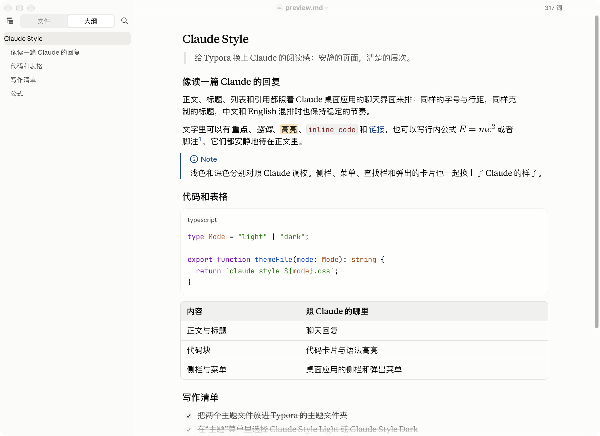
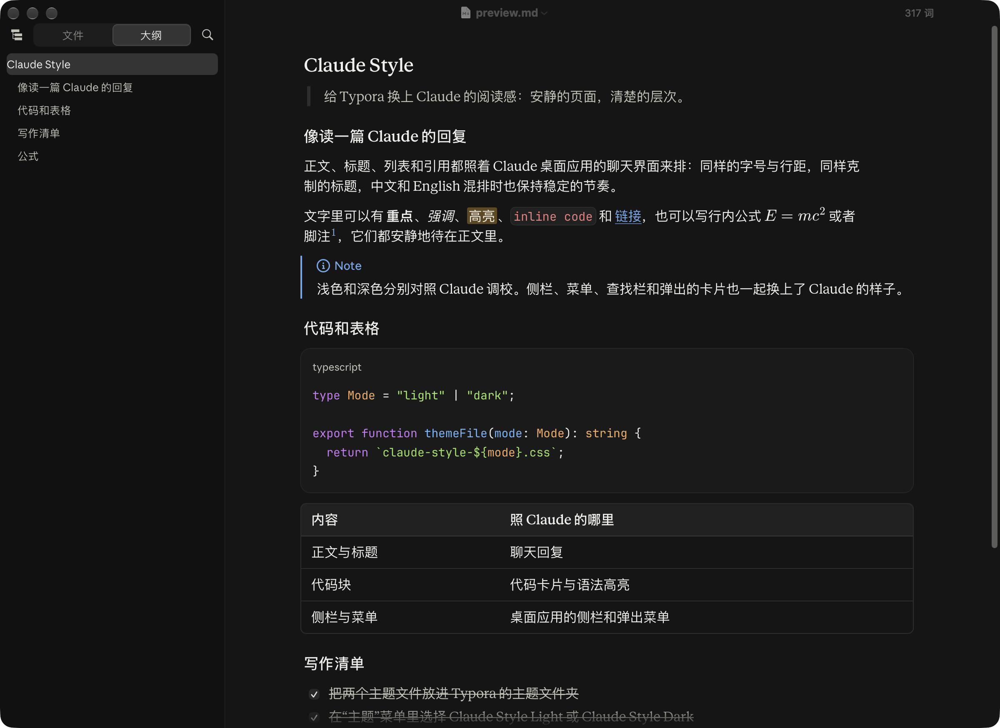
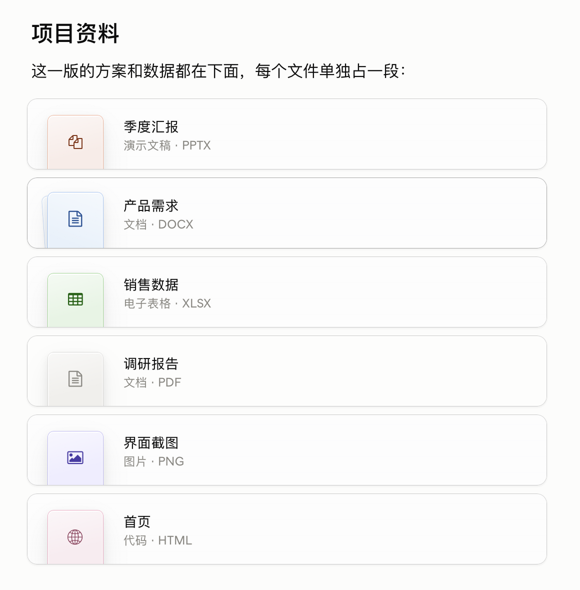
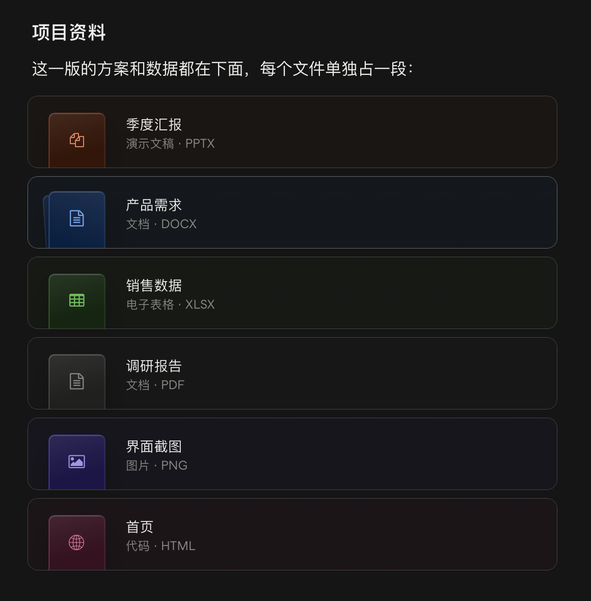

# Claude Style for Typora

[English](README.md) · 简体中文

一套浅色、一套深色的 [Typora](https://typora.io) 主题，让文档读起来像 Claude 里的一篇回复。正文、代码和表格照着 Claude 的聊天界面来排，提示框照 Claude 打开文档时的样子，单独成段的文件链接显示成 Claude 分享文件时的卡片，Typora 自己的界面（侧栏、菜单、浮动工具栏、查找栏、对话框）也一起换上了 Claude 的样子。

Claude Style 是独立制作的主题，不是 Anthropic 出品，也没有得到 Anthropic 的认可或支持；主题里不含 Anthropic 的字体、图标或其他文件。Claude 是 Anthropic 的商标。

## 预览

### Claude Style Light



### Claude Style Dark



### 文件卡片

单独成段的文件链接，浅色和深色（截图时鼠标停在第二张卡片上）：





## 适用环境

Claude Style 在 Mac 上精心设计，在 macOS、Windows 和 Linux 上全面测试。

测试报告：[Claude Style 1.2.4 Linux 完整测试报告](reports/claude-style-1.2.4-linux-test-report.html)（HTML 文件，下载后用浏览器打开）。

## 照的是哪一版桌面应用

桌面应用的界面会更新，Claude Style 因此分成两个系列：

- **1.2 系列**照 3.1623 版之后推出的新界面（3.6556 版）。它在继续更新，增强脚本也只适配它。
- **1.1 系列**照 2026 年 10 月的桌面应用（3.1623 版），也就是新界面推出以前的样子。它已不再更新，最后一版是 1.1.16，建议尽快换到 1.2 系列。

**两个系列有什么不同**

1.2 系列照搬了新界面的尺寸、间距、圆角、字号字重、布局和图标：

- **正文**：行距更紧凑，二到六级标题的字号统一，粗体略轻。
- **菜单**：图标更大，卡片的圆角更大，各处菜单的行高统一成一种。
- **侧栏**：顶上是"新建"和"搜索"两行，每一行更高；底栏也更高，右边有一把表示只读模式的锁（1.2.3 起）。
- **其他**：对话框、查找卡片、侧栏搜索和快速打开的卡片，大小和间距都照新界面。

颜色两个系列基本一样，只有一处不同：1.2 系列侧栏里的文件名和扩展名、大纲标题、"新建""搜索"、"项目列表"和底栏的文件夹名，一直用正文文字的颜色，比 1.1 系列更深。

**为什么 1.2 系列没有全盘照新界面**

新界面推出以后，接受度普遍不高，不少用户的反应比较强烈。它不只是换了尺寸和布局，还改了颜色和几样常用的部件：次要的文字和分隔线都更淡，深色模式下尤其明显；行内代码不再是红字，也没了边框；表格去掉了外框和表头的底色；文件卡片换成了一行一张、左边一个小图标的样式。这些改动让文档读起来不如以前清楚。

所以 1.2 系列只照新界面的骨架：尺寸、间距、布局和图标。颜色和下面几样部件保留 1.1 系列的样子：

- **颜色**：保留 1.1 系列的配色，文字和分隔线都更清楚。唯一照新界面改的是上面说的侧栏文字，因为新界面在这一处用了更深的颜色。
- **表格**：保留外框、圆角和表头的底色，行和列更容易看清。
- **行内代码**：保留红字和细边框，代码和正文分得更清楚。
- **文件卡片**：保留按文件类型着色的卡片，一眼就能认出是什么文件。

**设计理念**

Claude Style 想让 Typora 里的文档读起来像 Claude 里的一篇回复，所以能照桌面应用的地方都照着做，不另起炉灶；但照着做是为了读得舒服，不是为了一模一样。新界面里让文档变难读的改动，Claude Style 不跟；Typora 做不到的地方（比如透出桌面的毛玻璃），用最接近的样子代替。等桌面应用的新界面再有变化，或者用户对它的接受度明显提高以后，再视情况跟进。

## 安装

1. 从 [最新发布](https://github.com/Xv-Bowen/claude-style-typora/releases/latest) 下载 `claude-style-light.css` 和 `claude-style-dark.css`。
2. 在 Typora 里打开 **设置 → 外观 → 打开主题文件夹**。
3. 把两个文件复制进这个文件夹。
4. 退出 Typora 再重新打开，在 **主题** 菜单里选择 **Claude Style Light** 或 **Claude Style Dark**。

想跟着系统外观切换深浅：在 **设置 → 外观** 里打开 **在深色模式下使用独立的主题**，浅色模式选 Claude Style Light，深色模式选 Claude Style Dark。

Typora 运行时会把主题留在内存里。换成新版本的文件后，要退出 Typora 再打开；只在菜单里切换主题，Typora 不会重新读取主题文件。

1.1 系列已不再更新：问题只在 1.2 系列里修，增强脚本也只适配 1.2 系列，建议尽快换到 1.2 系列。仍想用 1.1 系列的样子，可以在[发布页](https://github.com/Xv-Bowen/claude-style-typora/releases)下载它的最后一版 1.1.16。

## 包括哪些部分

| 部分 | 效果 |
| --- | --- |
| 阅读 | Claude 的字号、行距和标题层级；链接、引用、列表、表格、键帽、任务列表和脚注都照 Claude 的样子 |
| 代码 | Claude 的代码卡片，带语言标签和 Claude 的语法高亮；指针移到卡片上时右上角出现复制按钮（装了增强脚本才能用）；行内代码也照 Claude 的样子 |
| 公式 | 和 Claude 里一样大 |
| 提示框 | GitHub 提示框（note、tip、important、warning、caution）照 Claude 显示文档时的样子：左边一条彩色竖线，第一行是带图标的彩色标题 |
| 图表 | Mermaid 图表用 Claude 画图表时的颜色 |
| 文件链接 | 单独成段的文件链接显示成 Claude 分享文件时的卡片：按文件类型配颜色和图标，写着名字，下面是类型和扩展名。⌘ 点击（Windows 和 Linux 上是 Ctrl 点击）打开文件；把光标放进去就能编辑链接。指向网页、邮箱、文档里某处或文件里某一部分的链接仍是链接。导出的 HTML 和 PDF 里不画卡片，文件链接也是普通链接（用了[增强脚本](#增强脚本可选)的导出代码，导出的文件里也画） |
| 图片 | 文字光标移到图片上时（点一下图片，或用方向键移过去），图片在窗口中间放大显示，窗口其余部分压暗，图片右上角有关闭按钮，和 Claude 看图时一样。点正文别处或用方向键离开，大图就收起；在 Mac 上，点关闭按钮也能收起（Windows 和 Linux 上见"你可能会问的问题"） |
| 侧栏 | 文件树、大纲和搜索照 Claude 侧栏的样子，包括侧栏里的菜单。"文件 / 大纲"切换下面是"新建"和"搜索"两行，和 Claude 侧栏顶上一样（中文界面写"新建""搜索"，英文界面写 New、Search，其他语言用 Typora 自己的词）；文件上面有小标题"项目列表"（不管 Typora 设成什么语言，都显示中文；装了增强脚本就跟着 Typora 的语言）。在 Mac 上，侧栏底部写着文件夹名的那一栏一直显示。侧栏底部那一栏里没有"文件树 / 文档列表"的切换按钮，要切换就用菜单"显示 → 文件树"或"显示 → 文档列表"。侧栏底部那一栏的右边有一把锁，表示文档是不是在只读模式（"显示 → 只读模式"）：可以编辑时锁开着，只读时锁上、按钮显示为按下。不装增强脚本时点它没有反应；装了脚本，点它就能切换。放不下的文件名在末尾渐渐淡出，和 Claude 侧栏一样；鼠标停在名字上会显示完整路径。侧栏搜索打开时，像 Claude 的搜索一样是一张浮在窗口中间的卡片：文件名和匹配到的行在同一个列表里，窗口其余部分压暗。卡片底部照 Claude 写着这时能按的键（没输入时是"关闭 Esc"，输入后是"选择 ↑ ↓"），右边是"区分大小写""查找整个单词""正则表达式"三个开关；这些字不管 Typora 设成什么语言，都显示中文（装了增强脚本就跟着 Typora 的语言） |
| 浮动工具栏 | 照 Claude 审阅栏的样子：按钮、菜单和子菜单都照 Claude 的方式打开和显示；一到六级标题收进"段落"的子菜单 |
| 查找和快速打开 | 查找替换栏是页面右上角的一张卡片，和 Claude 的查找栏一样；找不到时显示 0 / 0。快速打开放在 Claude 的搜索所在的位置，窗口其余部分压暗，每个结果一行：图标、名字，右边是它所在的文件夹；搜索结果像 Claude 的搜索一样把匹配的字加粗；卡片底部也写着这时能按的键 |
| 对话框和提示 | 对话框、通知和提示气泡照 Claude 的样子 |
| 浮动大纲窗口 | 照 Claude 文档里的目录卡片 |
| 文件预览 | 顶栏和"打开方式"按钮照 Claude 的文档面板 |
| 模式 | 源代码模式是一个纯代码视图；专注模式用 Claude 的弱化色淡化其他段落 |
| 动效 | 只有 Claude 里会动的地方才动，其余都是即时变化 |
| 导出 | HTML 和 PDF 与编辑器使用同一套样式（文件卡片只在编辑器里画；用了增强脚本的导出代码，导出的文件里也画） |

### 字体

装了下面的字体就用它们，没装就按顺序往后用：

| 用于 | 首选 | 依次回退到 |
| --- | --- | --- |
| 正文 | Anthropic Serif | Times New Roman，中文用苹方（Windows 上是微软雅黑） |
| 界面 | Anthropic Sans | 系统字体，中文用苹方（Windows 上是微软雅黑） |
| 代码 | JetBrains Mono NL | JetBrains Mono、Anthropic Mono、SF Mono、Menlo，中文用苹方（Windows 上是微软雅黑） |

主题不附带、也不下载任何字体，Anthropic 的字体不随主题分发。[JetBrains Mono](https://www.jetbrains.com/lp/mono/) 可以免费安装。

### 图标

界面上的图标都是 Typora 自带的：Typora 自己的图标字体、Font Awesome 和 Ionicons，主题只调整它们的颜色、大小和位置。Claude 有图标、Typora 却没画图标的地方（侧栏的文件夹菜单、浮动工具栏的菜单、快速打开、文件卡片），主题从 Typora 自带的图标里挑表示同一件事的配上。菜单里的对勾、子菜单的箭头和关闭用的叉是主题自己画的简单线条。主题里不带任何图标文件。Claude 的图标属于 Anthropic，不能随主题分发，所以这套主题没有使用 Claude 的图标。

### 打印和 PDF

打印和导出 PDF 跟随当前主题：浅色主题印在 Claude 的米白页面色上，深色主题整页是深色。要打印到纸上，最好先切到浅色主题。

HTML 导出里的代码和编辑器里一样保持一行、可以横向滚动；打印和 PDF 没法滚动，长代码行会换行。

## 增强脚本（可选）

主题只能改变 Typora 的外观。另有一个可选的脚本 `claude-style-enhance.js`，补上主题做不到的几件事。按钮和图标都由主题画出，脚本让它们起作用：不装脚本，主题照常使用，只是代码卡片的复制按钮和侧栏底部的锁点了没有反应；装了脚本，换成别的主题时脚本什么也不做。脚本不联网，也不改文档的内容。脚本只适配 1.2 系列：脚本 0.1.3 及以后的版本要配 Claude Style 1.2.3 或更新的版本，主题较旧时（包括 1.1 系列）脚本什么也不做。脚本 0.1.5（Claude Style 1.2.5 起）、0.1.4（Claude Style 1.2.4）、0.1.3（Claude Style 1.2.3）和 0.1.1（Claude Style 1.2.2）适配的是 Typora 1.14.15，0.1.0（Claude Style 1.2.1）适配的是 Typora 1.14.10。脚本要接上 Typora 自己的程序才能工作，Typora 以后的版本改了这些地方，脚本可能要跟着更新。

装上以后：

- **看图**：单击图片，或用方向键移到图片上，图片从原来的位置放大到窗口中间。可以用滚轮或触控板缩放，放大后可以拖动，双击在"适合窗口"和"原始大小"之间切换（本来就按原始大小显示的图片，双击放大一倍）。放大或拖动时，关闭按钮跟着图片的右上角走，始终留在窗口里。点关闭按钮或按 Esc 关闭，正文停在原来的位置。
- **单击不显示写法**：单击文件卡片或行内公式，不再显示它的 Markdown 写法；要编辑时双击，或按住 ⌥（Windows 和 Linux 上是 Alt）点击。
- **文件卡片**：卡片上写文件名，去掉扩展名，`_` 和 `-` 换成空格（`Q3_report-final.pptx` 写成"Q3 report final"）；认不出类型的文件，第二行也写上扩展名；图片文件的卡片带缩略图。
- **复制代码**：点代码卡片右上角的复制按钮，复制整段代码，按钮随后变成对勾。
- **只读**：点侧栏底部的锁，就能打开或关闭只读模式，和"显示 → 只读模式"是同一个开关；指针停在锁上时会提示"只读模式"。
- **侧栏搜索**：边输入边找，停下 0.5 秒就出结果，不用按回车；光标在哪里，按 Esc 都能关上搜索。一行里有好几处命中时，结果里的字不再重复。
- **方向键**：在侧栏搜索的结果和快速打开里，按 ↑ ↓ 一行一行地滚，不再一下跳好几行。
- **浮动工具栏**：块类型菜单能用 Esc 关上；工具栏刚打开时的英文 "Paragraph" 很快就换成"段落"。
- **大纲**：大纲里标出的是正在读的那一节。
- **最外层文件夹**：点最外层文件夹那一行就能收起、展开，重新打开 Typora 后还记得。
- **界面上的字**：主题写在界面上的中文（"项目列表"、搜索卡片和快速打开底部的按键说明、三个搜索开关）跟着 Typora 设置的语言显示；简体中文界面不变。
- **导出**：导出的 HTML 和 PDF 里也画文件卡片，带图标和缩略图；HTML 里代码卡片的复制按钮也能用。这要在 Typora 的导出设置里粘贴一段代码，见下面的[导出 HTML 和 PDF](#导出-html-和-pdf)。

### 安装脚本

先照[安装](#安装)装好主题，再从[最新发布](https://github.com/Xv-Bowen/claude-style-typora/releases/latest)下载 `claude-style-enhance.zip` 并解压。安装前先退出 Typora。

- **macOS**：打开"终端"，输入 `bash` 和一个空格，把解压出来的 `install-mac.sh` 拖进终端窗口，按回车。Typora 不在"应用程序"文件夹里时，在最后再加一个空格和 Typora.app 的路径。如果终端提示 "macOS does not let this terminal change Typora"，在 **系统设置 → 隐私与安全性 → App 管理** 里允许"终端"，再运行一次。
- **Windows**：右键点 `install-windows.ps1`，选"使用 PowerShell 运行"。Typora 装在只有管理员能改的文件夹里时，会请求管理员权限。
- **Linux**：在终端里进入解压出来的文件夹，运行 `sudo bash install-linux.sh`。找不到 Typora 时，在最后加上 `--path` 和 Typora 所在的文件夹。

装好后打开 Typora，选择 Claude Style Light 或 Claude Style Dark。

安装脚本只在 Typora 自己的页面文件里加一行，从主题文件夹加载 `claude-style-enhance.js`，改之前先备份这个文件。Typora 每次更新都会换回它自己的文件，所以更新 Typora 后要再运行一次安装脚本。

#### 不用安装脚本

安装脚本只做两件事，也可以自己做，或者交给你用的 AI 工具去做。先退出 Typora，备份要改的页面文件：

1. 把 `claude-style-enhance.js` 复制进 Typora 的主题文件夹（**设置 → 外观 → 打开主题文件夹** 打开的那个）。
2. 在 Typora 自己的页面文件里，紧接着下面写的那一行，加上一行：

- **macOS**：页面文件是 `/Applications/Typora.app/Contents/Resources/TypeMark/index.html`。在 `<script src="./appsrc/main.js" aria-hidden="true" defer></script>` 后面加：

  ```html
  <script src="file:///Users/你的用户名/Library/Application%20Support/abnerworks.Typora/themes/claude-style-enhance.js" defer data-claude-style-enhance></script>
  ```

  "你的用户名"换成你的用户文件夹的名字；这是一个网址，空格写成 `%20`，用户名里有中文等字符时也要照网址编码。macOS 不让改这个文件时，在 **系统设置 → 隐私与安全性 → App 管理** 里允许你用来改它的程序。
- **Windows 和 Linux**：页面文件是 Typora 文件夹里的 `resources/window.html`（Windows 上常在 `C:\Program Files\Typora`，Linux 上常在 `/usr/share/typora` 或 `/opt/typora`）。在 `<script src="./appsrc/window/frame.js" defer="defer"></script>` 后面加（有的版本写的是 `./app/window/frame.js`）：

  ```html
  <script src="typora://app/userData/themes/claude-style-enhance.js" defer data-claude-style-enhance></script>
  ```

  Typora 1.4 以前的版本把 `typora://app/userData` 换成 `typora://userData`。Windows 上要存成不带 BOM 的 UTF-8，否则 Typora 打开是空白窗口。

Typora 更新后要再加一次这一行。卸载时删掉这一行和主题文件夹里的 `claude-style-enhance.js`。

### 导出 HTML 和 PDF

导出的文件里不带装好的脚本。想让导出的 HTML 和 PDF 也画文件卡片，把解压出来的 `claude-style-export-head.txt` 的全部内容粘进 Typora 的导出设置（不装脚本也能用）：

- HTML：**设置 → 导出 → HTML**，粘进"在 `<head />` 中添加"。
- PDF：**设置 → 导出 → PDF**，粘进"插入额外内容 (HTML)"。

导出时用的是 Claude Style 主题，这段代码才起作用。

### 卸载脚本

退出 Typora，用安装时的方法运行同一个文件夹里的 `uninstall-mac.sh`、`uninstall-windows.ps1` 或 `uninstall-linux.sh`。它从 Typora 的页面文件里删掉那一行，再删掉主题文件夹里的脚本；粘进导出设置的代码要自己删掉。

## 你可能会问的问题

### 设计上的选择

**为什么没勾选的子任务也被划掉了？**\
Claude 就是这样：勾选一项任务后，整项连同下面的子任务都变灰、加删除线。子任务自己的复选框仍然是空的。

**为什么是两个主题文件，而不是一个跟随系统的文件？**\
Typora 的主题菜单里一个主题文件就是一项，只有一个文件就没法自己选浅色或深色了，比如系统是深色时想切到浅色主题再打印。导出的 HTML 页面也会跟着看的人的系统变色。两个文件也能跟着系统外观切换，做法见[安装](#安装)。

### 主题做不到的地方

Typora 和系统本来就是这样，主题能改的只有外观。其中几条装了[增强脚本](#增强脚本可选)可以补上，答案里写了。

**为什么 Typora 有些地方还是系统的样子？**\
在 macOS 上，这些部分由系统绘制，不在主题能改的网页里：右键菜单、标题栏里的菜单、确认对话框、标题栏上的按钮、窗口标签页、链接标题的悬停提示、正文光标的粗细，以及设置窗口。

**为什么侧栏不是透出桌面的 Liquid Glass（毛玻璃）？**\
Typora 的窗口在 Mac 上是不透明的：主题把背景设成半透明，透明的部分也只会露出黑色或白色，透不出桌面。所以 macOS 的 Liquid Glass 效果，主题做不出来。

**为什么放大的图片不能像 Claude 那样缩放或下载？**\
主题只能改变 Typora 的外观，缩放和下载需要脚本，主题加不了。主题能借用的是 Typora 自己的状态：文字光标在图片上时，Typora 会展开这张图片的源码，主题就在这时把图片放大显示，并把源码藏起来；光标离开，大图就收起。所以大图开着时，光标其实还在源码里，这时打字会改到图片的写法；要改图片的路径或说明，请用源代码模式。可选的[增强脚本](#增强脚本可选)换上一个单独的看图层，能缩放和拖动；看图层里没有下载按钮。

**为什么不装增强脚本时，点放大图片的关闭按钮有时没有反应？**\
不装脚本时，大图靠的是 Typora 自己的状态（见上一条）：文字光标在图片上时放大，光标离开就收起。主题只能画出关闭按钮，接不了点击，所以点它其实是在正文里点了一下；大图收不收，要看 Typora 把光标放在哪里。在 Mac 上，光标落到图片外面，大图就收起；在 Windows 和 Linux 上，光标可能还留在图片里，大图就不收。这时请点正文别处，或用方向键把光标移开。装了[增强脚本](#增强脚本可选)，图片在单独的看图层里打开，点关闭按钮或按 Esc 都能关上。

**为什么侧栏搜索要按回车才出结果，按 Esc 有时也关不掉？**\
这两点都是 Typora 自己的做法：侧栏搜索输完按回车才开始找；Esc 只在光标在输入框里时才关闭搜索。主题改不了按键和搜索方式。想边输入边按文件名找，可以用"文件"菜单里的"快速打开"。光标不在输入框里时，可以点卡片右上角的关闭按钮，或者再按一次 ⇧⌘F（Windows 和 Linux 上是 Ctrl+Shift+F），光标会回到输入框。装了增强脚本，输入时就开始找；光标在哪里，按 Esc 都能关上搜索。

**为什么在快速打开里按下方向键，列表会一下跳好几行？**\
这是 Typora 自己的滚动方式：选中的一行走到列表底部时，Typora 把它直接滚到列表最上面；按上方向键时一行一行地滚。主题改不了这段程序，用 Typora 自带的主题也是这样。选中的一行始终看得见。装了增强脚本，按下方向键也一行一行地滚。

**为什么最外层文件夹前面的小三角点了不会收起？**\
Typora 不让最外层的文件夹收起，它本来也不画这个三角。主题画上它，只是为了和下面的文件夹对齐，点了没有作用。装了增强脚本，点最外层文件夹那一行就能收起。

**为什么一长串网址只有前面一段是链接？**\
没写成链接语法的网址，在哪里结束由 Typora 判断，遇到里面的中文（比如 `?query=中文`）就停下。用 Typora 自带的主题也是这样。

**为什么文件卡片和 Claude 的有点不一样？**\
主题读不到文件，也改不了链接上显示的文字，所以卡片上的名字就是链接文字（Claude 写的是文件名），图片和 PDF 没有缩略图，也没有下载按钮；⌘ 点击（Windows 和 Linux 上是 Ctrl 点击）打开文件。主题认不出类型的文件，第二行只写"文件"，不带 Claude 会写的扩展名。指向文档里某处或文件里某一部分的链接仍是链接，Claude 的回复里它们是普通文字。装了增强脚本，卡片上写文件名，认不出的类型也写上扩展名，图片带缩略图；PDF 仍没有缩略图，也没有下载按钮。

**为什么有些生僻字显示成方框？**\
主题不带字体。系统里装的字体都没有的字，比如 𠀀（U+20000），无论用什么主题都显示成方框。装一个包含这些字的字体就能显示。

**为什么用 Tab 键到不了侧栏底部的锁？**\
锁是主题画在 Typora 底栏上的，底栏上的按钮 Typora 都没让 Tab 键到达。用键盘时，可以从菜单"显示 → 只读模式"切换。

### 已知问题

下面这些是确实不对、还没修好的地方。除了最后一条，毛病都出在 Typora、系统或桌面环境上，主题改不了；能绕开的，答案里写了办法。

**为什么侧栏打开时，标题栏里的文件名没有在右边那块里居中？**\
文件名是 macOS 原生标题栏画的，不在主题能改的网页里。侧栏打开时，Typora 会请标题栏把文件名挪到侧栏右边居中，但在 macOS 27 和 Typora 1.14.10 上，标题栏没有照办，换成 Typora 自带的主题也一样。

**为什么按 Esc 关不掉浮动工具栏的块类型菜单？**\
这个菜单是 Typora 自己的，用 Typora 自带的主题按 Esc 也关不掉。点菜单外面，或者再点一次按钮，就能关上。装了[增强脚本](#增强脚本可选)，按 Esc 就能关上这个菜单。

**为什么浮动工具栏刚打开时，块类型写着英文 "Paragraph"？**\
这是 Typora 自己的时序：工具栏比界面的中文先建好，点一下正文就会变成"段落"。用 Typora 自带的主题也一样。装了增强脚本，它很快就会自己换成"段落"。

**为什么侧栏搜索的结果里，有些字重复了？**\
一行里有好几处命中时，Typora 拼结果时会把每处命中前面的字都带上，于是有些字出现两次（在"Alpha alpha alphabet"里搜 alpha，结果显示成"AlphaAlpha alphaAlpha alpha alphabet"）。命中的次数是对的。用 Typora 自带的主题也一样，主题改不了；装了[增强脚本](#增强脚本可选)，结果就按原文显示，不再重复。

**为什么只读模式下还能勾选任务？**\
只读模式是 Typora 的，它不挡点击任务复选框；在 Linux 上，按回车也可能改动内容。侧栏底部的锁只是替你切换这个模式，管不了它挡住哪些操作。用 Typora 自带的主题也一样。

**为什么在 Linux 上按住 Alt 点击文件卡片或公式，进不了编辑？**\
不少 Linux 桌面用按住 Alt 拖动来移动窗口（Xfce 默认就是这样），按住 Alt 的点击会先被窗口管理器拿走，到不了 Typora。可以改用双击，或者在桌面的设置里把移动窗口的键换掉。

**为什么窗口很窄时，表格工具栏的"更多"跑到了第二行？**\
在 Windows 和 Linux 上，表格工具栏有一个"更多"按钮。主题的工具栏按钮照 Claude 是 28px，比 Typora 自带主题的大，窗口很窄又开着侧栏时一行放不下，"更多"就换到第二行，压在表头上，照样能用。Mac 版的表格工具栏没有"更多"按钮。

### 版本

**1.1 系列以后还会更新吗？**\
不会。1.1 系列已经停止更新：问题只在 1.2 系列里修，增强脚本也只适配 1.2 系列，建议尽快换到 1.2 系列。发布页上 1.1 系列的各版一直保留，最后一版是 1.1.16。

**版本号为什么变了？**\
2026 年 10 月 26 日起，版本号的第二位表示照的是哪一版桌面应用的界面：1.1 系列照原来的界面，1.2 系列照新界面，第三位按发布的先后排。原来的 1.0.0 到 1.3.9 改成了 1.1.0 到 1.1.15，原来的 2.0.0 和 2.1.0 改成了 1.2.0 和 1.2.1。每一版的文件都没有变。

## 自定义

Typora 会在主题之后加载主题文件夹里的两个可选文件，不用改主题文件就能调整：

- `base.user.css` 对所有主题生效；
- `claude-style-light.user.css`、`claude-style-dark.user.css` 分别只对一套主题生效。

例如给正文换一种字体：

```css
:root {
    --font-text: "Source Han Serif SC", serif;
}
```

界面字体和代码字体分别是 `--font-ui` 和 `--font-code`。

## 反馈

发现哪里不对，欢迎 [提交 issue](https://github.com/Xv-Bowen/claude-style-typora/issues)，附上截图、Typora 的版本和所用的系统（macOS、Windows 或 Linux 及其版本）。

## 许可证

Claude Style 采用 [知识共享 署名-非商业性使用-禁止演绎 4.0 国际许可协议](LICENSE)（CC BY-NC-ND 4.0）。

- 可以使用，也可以原样转发给别人，但只限非商业用途，并且要注明作者。
- 不可以分享修改过的版本，也不可以用于商业用途。
- 用 Typora 的 `.user.css` 文件为自己调整（见[自定义](#自定义)）没有问题。

主题里给导出页面用的图标轮廓取自 Font Awesome 4.1.0（SIL OFL 1.1）和 Ionicons 2.0.1（MIT），沿用各自的许可。

其他用途请先联系作者。
